# Демо по шагам

Здесь те же шаги, что в [видео](https://drive.google.com/drive/folders/1od5m5vRU6JMe4mRE5WnyC5GUvmEibjjZ), только скриншотами и с пояснениями. Пример собран на трёх фото творога «Савушкин» из [Open Food Facts](https://world.openfoodfacts.org/product/4810268016806) (лицевая сторона, этикетка с составом и боковая сторона с массой). Черновик собирался без кэша на ноутбуке без видеокарты и занял 34 секунды.

## 1. Загрузка фото

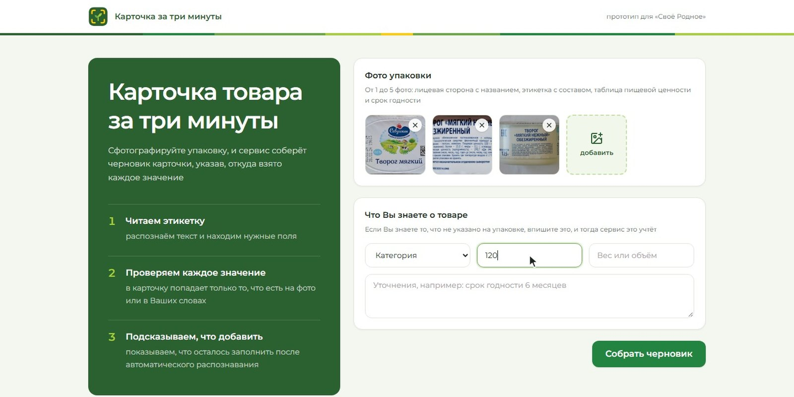

Фермер загружает от 1 до 5 фото упаковки. Если он знает то, чего нет на упаковке, он вписывает это сам, например категорию, массу или уточнения. Цену сервис не угадывает, поэтому её всегда вписывает фермер, здесь 120 ₽.

## 2. Обработка

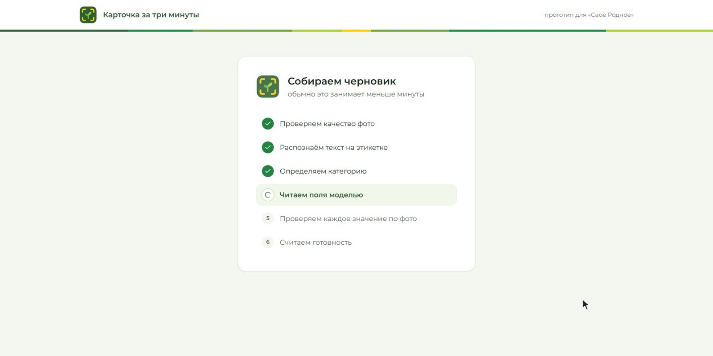

Сервис проверяет качество фото, распознаёт текст на этикетке (RapidOCR), определяет категорию (SigLIP 2), просит модель Qwen3-VL найти значения полей, проверяет каждое значение по фото и считает готовность. Распознавание текста заняло 13 секунд, ответ модели 14 секунд, весь черновик 34 секунды.

## 3. Черновик, готовность и модерация

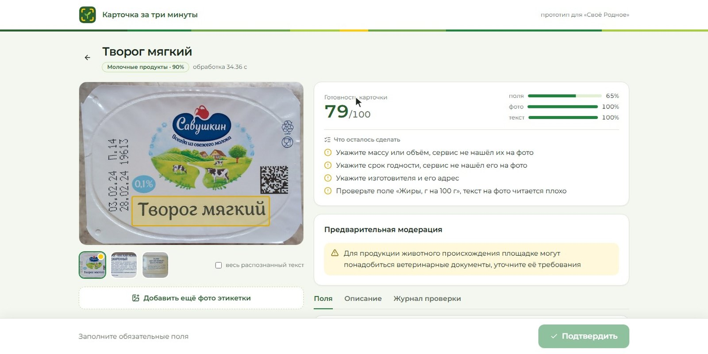

В черновик попадает только то, что найдено на фото. Категория «Молочные продукты» определена с уверенностью 90%.

Готовность 79 из 100. Обязательные поля дают до 60 баллов, они заполнены на 65%, поэтому получилось 39 баллов. Фото и текст получили полные 20 и 20. В списке «Что осталось сделать» сервис просит указать массу, срок годности и изготовителя, которых он не нашёл на фото, и проверить жиры, потому что этот текст на фото читается плохо.

Предварительная модерация предупреждает, что для продукции животного происхождения площадке могут понадобиться ветеринарные документы.

## 4. Откуда взято значение

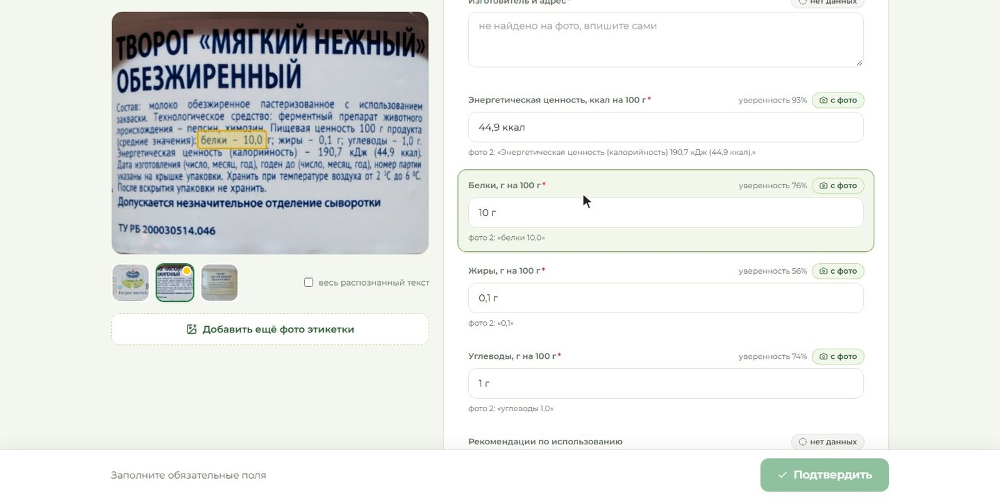

У каждого поля указаны источник, уверенность и цитата с фото. Если выбрать поле, на фото появляется рамка вокруг текста, из которого взято значение. Здесь белки 10 г взяты со второго фото из строки «белки - 10,0 г».

## 5. Журнал проверки

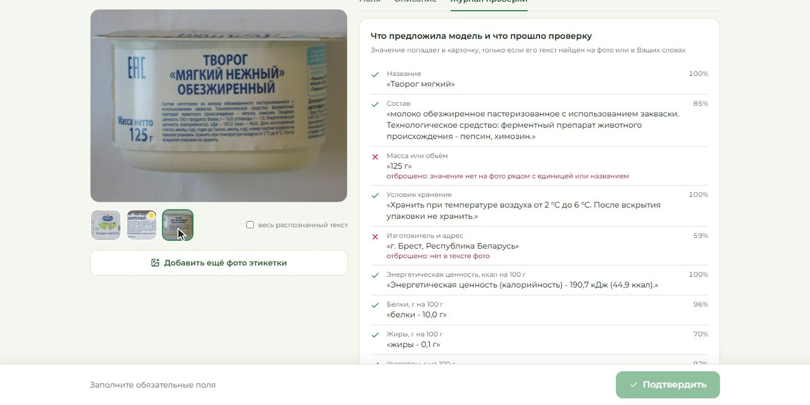

В журнале видно, что предложила модель и что прошло проверку. Модель предложила массу «125 г», но распознавание прочитало строку на третьем фото как «125 крышке упаковки...», без «г» и без слов «Масса нетто». Число принимается, только если рядом стоит единица измерения или название поля, поэтому массу сервис не принял и просит её вписать. Изготовитель «г. Брест, Республика Беларусь» тоже отброшен, потому что распознанный текст совпал с ним только на 59%.

Масса на фото есть, так что это ложный отказ. Сервис устроен так, что лучше оставить поле пустым и попросить фермера, чем вписать непроверенное значение.

## 6. Описание

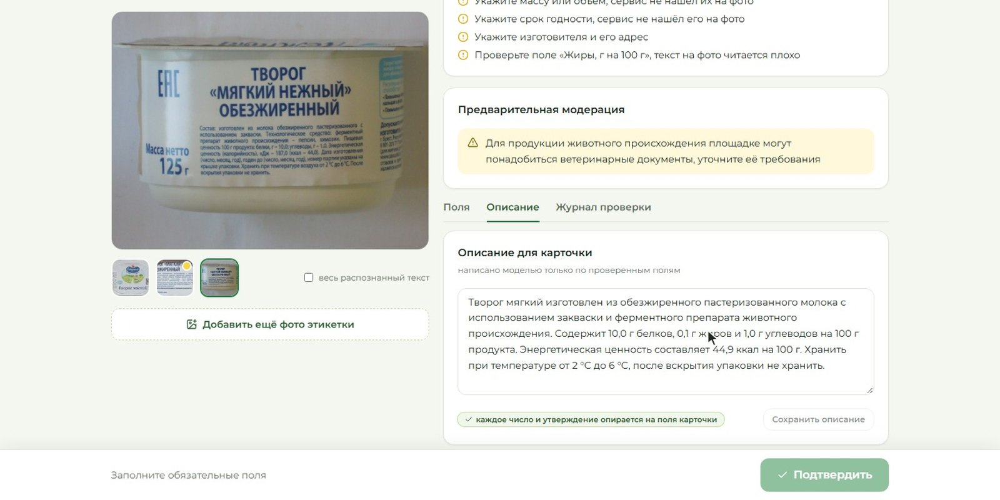

Описание модель пишет только по проверенным полям. Затем код сверяет каждое число и утверждение в тексте с полями карточки, если находит лишнее, просит модель переписать текст, а после двух неудачных попыток собирает описание по шаблону.

## 7. Дополнения фермера

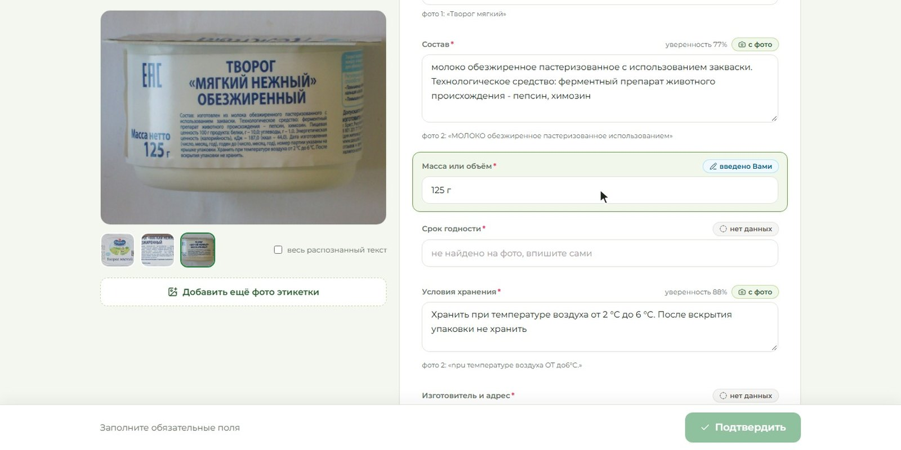

То, чего сервис не нашёл на фото, фермер вписывает сам. Здесь это масса 125 г, срок годности 25 суток (от даты изготовления 03.02.24 до даты «годен до» 28.02.24 на крышке) и изготовитель. Такие значения помечены «введено Вами», а в API у них источник `edited`.

## 8. Сервис не уверен в значении

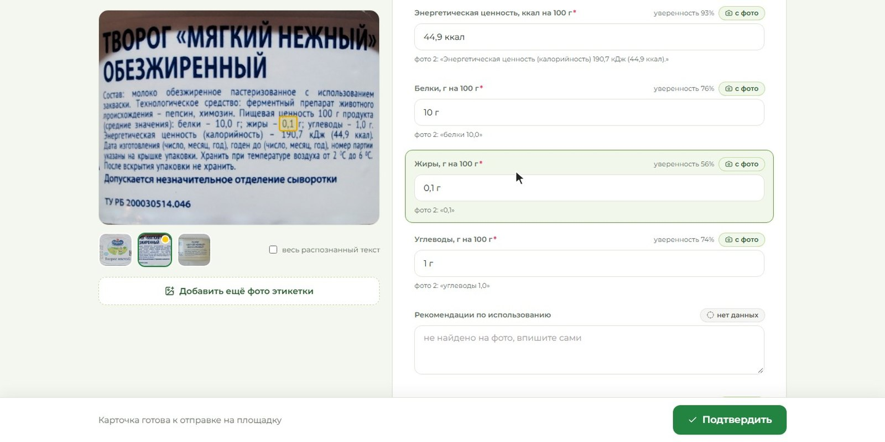

Жиры распознаны с низкой уверенностью, поэтому сервис просит сверить их с фото. Фермер выбирает поле, видит рамку вокруг «0,1» на втором фото и подтверждает значение, вписав его сам.

## 9. Карточка готова

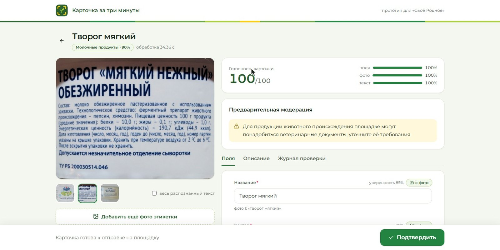

После всех дополнений готовность 100 из 100, и карточку можно подтвердить. Если бы остались блокирующие замечания модерации, например контакты в описании или масса со слов фермера, которая расходится с этикеткой, подтвердить карточку было бы нельзя.

## 10. Готовая карточка

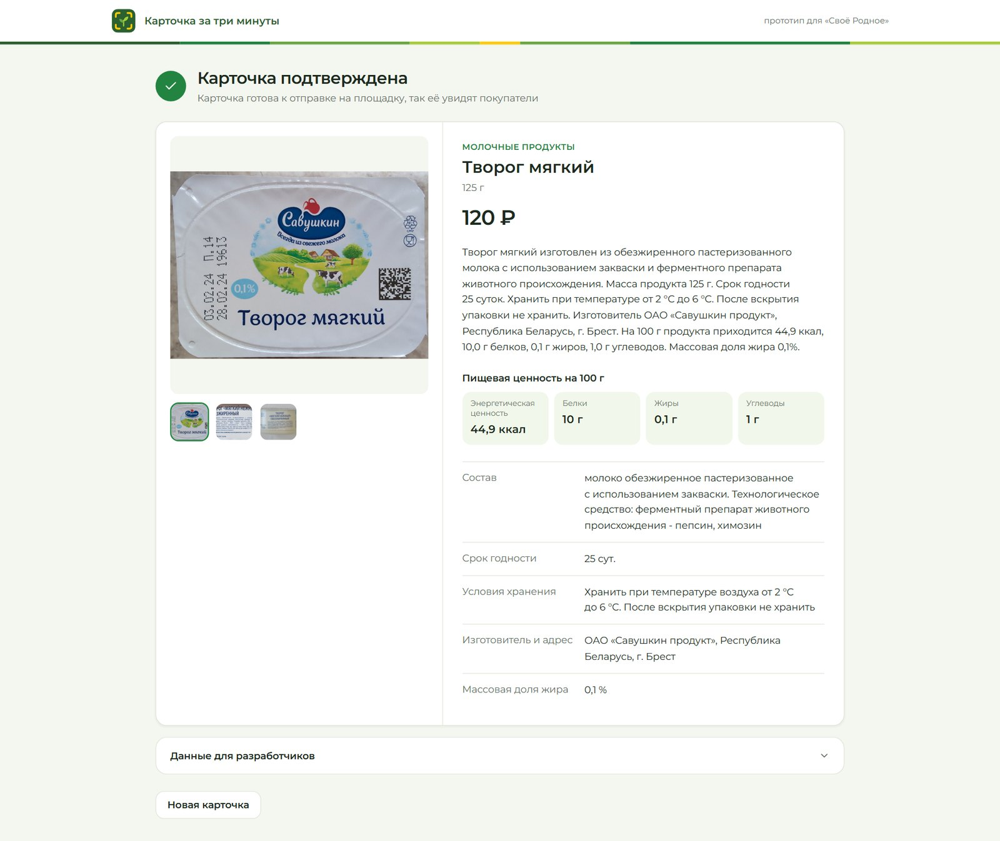

Фермер подтверждает карточку, и она готова к отправке на площадку. Сервис показывает её такой, какой её увидят покупатели, с фото, ценой, описанием, пищевой ценностью и остальными полями.

## 11. Данные для площадки

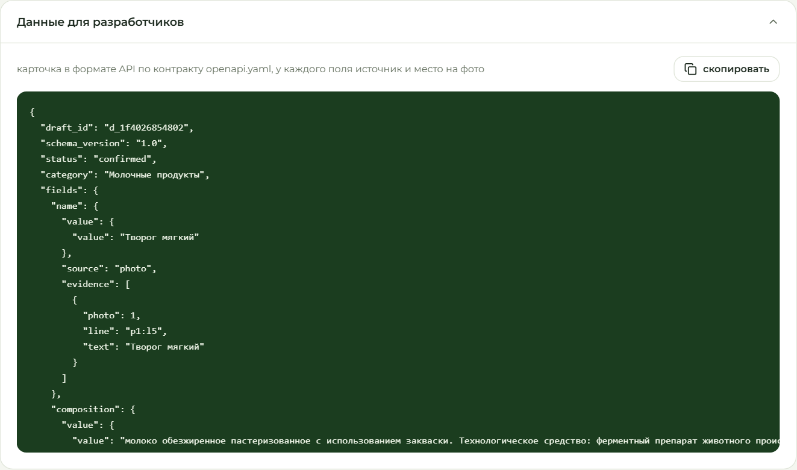

Под карточкой лежит её JSON, у каждого поля указаны значение, источник (`photo`, `farmer` или `edited`) и место на фото, т.е. номер фото, строка и цитата. Полный черновик с рамками на фото, готовностью, замечаниями модерации и журналом проверки площадка получает запросом `GET /v1/drafts/{id}` по контракту [openapi.yaml](../openapi.yaml), поэтому может перепроверить любое значение.

## Если фото плохое

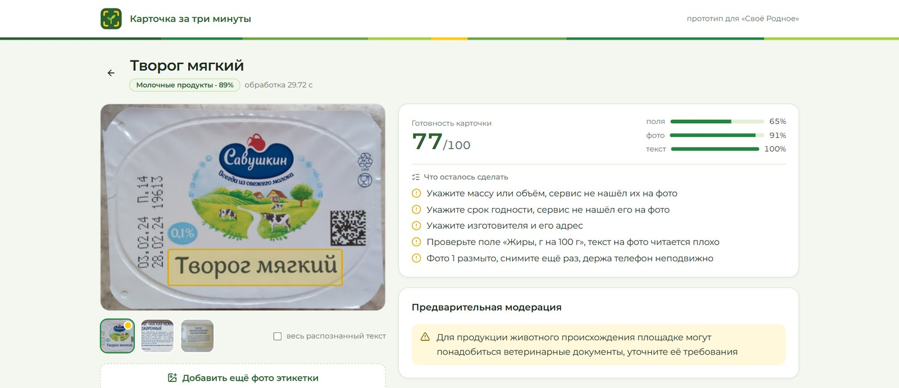

Для этого примера лицевая сторона специально размыта. Сервис замечает это по резкости снимка (variance of Laplacian в OpenCV ниже порога) и пишет «Фото 1 размыто, снимите ещё раз, держа телефон неподвижно». Название с размытого фото всё равно прочитано, оценка за фото снизилась до 91%, а готовность до 77.

Фото творога взяты из Open Food Facts и распространяются по лицензии CC BY-SA, по ней же распространяются скриншоты в этой папке. [Слайды](slides.pdf) с описанием решения и результатами оценки лежат рядом.
